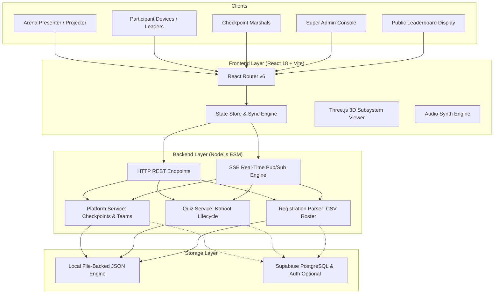

# 🤖 Robothon 3.0 — Autonomous Robotics Competition & Event Scoring Platform

[](https://nodejs.org/)
[](https://react.dev/)
[](https://www.typescriptlang.org/)
[](https://vitejs.dev/)
[](https://tailwindcss.com/)
[](https://supabase.com/)
[](LICENSE)

An enterprise-grade, real-time competition management and scoring platform purpose-built for robotics hackathons, boat-building challenges, and live arena tech events. 

The platform seamlessly combines **physical milestone verification**, a **Kahoot-style synchronized arena quiz system**, **minigame bonus & deduction controls**, **CSV team roster onboarding**, and a **real-time global leaderboard**.

---

## 📑 Table of Contents

- [Overview](#-overview)
- [Key Features](#-key-features)
  - [1. Arena Stage Presenter (Kahoot-Style)](#1-arena-stage-presenter-kahoot-style)
  - [2. Participant Portal & Terminal](#2-participant-portal--terminal)
  - [3. Checkpoint Marshal Portal](#3-checkpoint-marshal-portal)
  - [4. Super Admin Quiz & Registration Suite](#4-super-admin-quiz--registration-suite)
  - [5. Global Real-Time Leaderboard](#5-global-real-time-leaderboard)
- [System Architecture](#-system-architecture)
- [Tech Stack](#-tech-stack)
- [Repository Structure](#-repository-structure)
- [Getting Started](#-getting-started)
  - [Prerequisites](#prerequisites)
  - [Installation](#installation)
  - [Running Backend](#running-backend)
  - [Running Frontend](#running-frontend)
- [Configuration & Dual Backend Modes](#-configuration--dual-backend-modes)
- [Demo Credentials](#-demo-credentials)
- [API Reference](#-api-reference)
- [Testing & Quality Assurance](#-testing--quality-assurance)

---

## 🌟 Overview

During fast-paced robotics events (e.g., autonomous boat design, electrical wiring, ESP32 telemetry, water trials), organizers face chaotic coordination:
1. Physical boat inspections are hard to track and log without bias or delays.
2. Quizzes are traditionally asynchronous, prone to tab switching, and disconnected from the arena atmosphere.
3. Points from mini-games, rule penalties, and surprise challenges are scattered across spreadsheets.
4. Team rosters and leader accounts take hours to set up manually.

**Robothon 3.0 Platform solves all of this in one cohesive, real-time system.**

---

## 🚀 Key Features

### 1. Arena Stage Presenter (Kahoot-Style)
* **Big-Screen Presentation**: Designed specifically for arena projectors and auditorium displays.
* **Stage Synchronization**: Questions, options, and countdowns appear exclusively on the presenter screen.
* **Light / Dark Mode**: Dedicated projector-friendly Light Mode toggle with ambient contrast control.
* **Sound Effects & Audio Feedback**: Integrated synth-based audio for countdown ticks, answer locks, transitions, and round conclusions.
* **Strict Control**: Quizzes can **only** be initiated from the Arena Presenter view by Super Admins.
* **Automatic Participant Sync**: When a quiz starts, all connected team terminals are automatically redirected into the synchronized answering terminal.

### 2. Participant Portal & Terminal
* **3D Bot Viewer**: Interactive WebGL 3D robot viewer (Three.js) breaking down subsystems: Chassis, Motors, L298N driver, ESP32, Battery, and Wires.
* **Milestone Clearances**: Real-time physical checkpoint verification workflow (`CP 01` to `CP 05`).
* **Live Answering Terminal**: Participants see color-coded, labeled answer buttons without leaking full question stems onto mobile devices, preventing early answers or offline scraping.
* **Team Roster Display**: Displays the Team Leader's name alongside all registered teammate names directly in the dashboard header.
* **Elimination Round Alerts**: Teams that do not pass elimination cutoffs receive a prominent, respectful Elimination Notice Banner and status badge.
* **Verified Activity Log**: Receipt list showing cleared checkpoints, evaluated quizzes, bonus awards, and point adjustments.

### 3. Checkpoint Marshal Portal
* **Verification Queue**: Filter reviews by `Pending`, `Assigned to me`, `Reviewed`, or search by team.
* **Physical Approvals**: One-click approval (`+Points`) or rejection with instant participant UI updates.
* **Award Bonus Points**: Quick entry form to award custom mini-game points (e.g., Hydro Ping Pong, Wire Speedrun).
* **Deduct / Lower Points**: Dedicated penalty/deduction form with an optional reason field (e.g., rule infraction, late start, score correction).
* **Remove Mistaken Marks**: Team-specific activity log inspection allowing marshals to revert an accidental score or checkpoint approval with a single click.

### 4. Super Admin Quiz & Registration Suite
* **Full Quiz Lifecycle**: `DRAFT` ➔ `READY` ➔ `COUNTDOWN` ➔ `LIVE` ➔ `PAUSED` ➔ `RESULTS` ➔ `FINALIZED`.
* **Question Builder**: Create and edit MCQs with custom points, individual question durations, and private answer keys.
* **Elimination & Standard Rounds**: Configurable qualification cutoffs (`TOP_K`) and debarring mechanisms.
* **CSV Roster Upload**: Drag-and-drop registration CSV file parsing with automatic team creation, credentials generation, and roster persistence.

### 5. Global Real-Time Leaderboard
* **Live Composite Scoring**: Total points computed from:
  $$\text{Total Points} = \text{Checkpoint Points} + \text{Finalized Quiz Points} + \text{Mini-Game Adjustments}$$
* **Deterministic Tie-Breaking**: Ranks sorted by Total Points ➔ ID / Timestamp.
* **Audit Trail**: Transparent point history visible to participants and audience alike.

---

## 🏗️ System Architecture



---

## 💻 Tech Stack

### Frontend
- **Framework**: [React 18](https://react.dev/) + [Vite 5](https://vitejs.dev/)
- **Language**: [TypeScript 5.6](https://www.typescriptlang.org/)
- **Styling**: [Tailwind CSS 3.4](https://tailwindcss.com/)
- **3D Graphics**: [Three.js](https://threejs.org/)
- **Animations & Icons**: [Motion](https://motion.dev/), [GSAP](https://gsap.com/), [Lucide React](https://lucide.dev/)
- **Routing**: [React Router DOM v6](https://reactrouter.com/)

### Backend
- **Runtime**: [Node.js](https://nodejs.org/) (>= v20, native ECMAScript Modules)
- **Networking**: Node Native HTTP server, SSE (Server-Sent Events) Pub/Sub
- **Database / State Engine**: Dual mode — Local atomic JSON engine (`quiz-state.json`) or Cloud [Supabase](https://supabase.com/) (`@supabase/supabase-js`)
- **Testing**: Node.js Native Test Runner (`node --test`)

---

## 📁 Repository Structure

```text
robothon-1/
├── .gitignore                   # Production-grade gitignore (logs, build, env, state)
├── README.md                    # Project documentation
├── backend/
│   ├── data/
│   │   ├── demo-accounts.json   # Seed admin and marshal accounts
│   │   └── quiz-state.json      # Runtime database state (auto-created in local mode)
│   ├── examples/                # Example quiz JSON templates
│   ├── server/
│   │   ├── index.js             # HTTP server & routing logic
│   │   ├── auth-context.js      # Session & role-based access control
│   │   ├── platform-service.js  # Checkpoints, team scores, deductions & removals
│   │   ├── quiz-service.js      # Kahoot engine, countdowns, lifecycle & evaluation
│   │   ├── quiz-store.js        # Atomic storage abstractions
│   │   └── registration-parser.js # CSV team roster ingestion
│   ├── tests/
│   │   ├── quiz-service.test.js # 39 comprehensive quiz unit tests
│   │   └── platform-deduct-remove.test.js # Bonus, deduction & mark removal tests
│   └── package.json
└── frontend/
    ├── public/                  # Public web assets
    ├── src/
    │   ├── components/
    │   │   ├── admin/           # Review modal, bonus points forms
    │   │   ├── bot/             # Three.js 3D Bot Viewer component
    │   │   ├── common/          # PillNavbar, alerts, buttons
    │   │   ├── leaderboard/     # Score filters, podium cards
    │   │   ├── participant/     # Quiz status watcher, scored items receipts
    │   │   └── splash/          # Mechanical helmet splash animation
    │   ├── pages/
    │   │   ├── admin/           # Arena Presenter, Question Builder, Registrations
    │   │   ├── participant/     # Participant Dashboard, Answering Terminal, Waiting Room
    │   │   └── public/          # Login, Live Leaderboard, Splash
    │   ├── routes/              # AppRoutes definition & route guards
    │   ├── services/            # API client, stateStore, quizService, audio
    │   └── mockData.ts          # Shared TypeScript models and definitions
    ├── package.json
    └── vite.config.ts
```

---

## ⚡ Getting Started

### Prerequisites
- **Node.js**: `v20.0.0` or higher ([Download Node.js](https://nodejs.org/))
- **npm**: `v9.0.0` or higher

### Installation

1. Clone the repository:
   ```bash
   git clone https://github.com/ShubhamBhrdwj/website-quiz-integration.git
   cd website-quiz-integration
   ```

2. Install backend dependencies:
   ```bash
   cd backend
   npm install
   ```

3. Install frontend dependencies:
   ```bash
   cd ../frontend
   npm install
   cd ..
   ```

---

### Running Backend

From the `backend` directory:
```bash
cd backend
npm run dev
```
> The API server will start on **`http://localhost:8787`**.

---

### Running Frontend

From the `frontend` directory:
```bash
cd frontend
npm run dev
```
> The web application will launch on **`http://localhost:3000`** (or `5173`).

---

## ⚙️ Configuration & Dual Backend Modes

The backend supports two operation modes configured via `backend/.env`:

```env
# backend/.env

# Option 1: Zero-Config Local Mode (Recommended for local testing & development)
DATA_BACKEND=local
PORT=8787

# Option 2: Cloud Supabase Mode (For multi-server or cloud deployments)
# DATA_BACKEND=supabase
# PORT=8787
# SUPABASE_URL=https://YOUR_PROJECT.supabase.co
# SUPABASE_PUBLISHABLE_KEY=your-publishable-key
# SUPABASE_SECRET_KEY=your-server-secret-key
```

- In **`local` mode**, the server stores state in atomic, recoverable JSON files under `backend/data/quiz-state.json`.
- In **`supabase` mode**, accounts, teams, and attempts are persisted to your PostgreSQL tables.

---

## 🔑 Demo Credentials

The system comes pre-seeded with accounts for testing across all role levels:

| Role | ID / Login | Email | Password | Access Level |
| :--- | :--- | :--- | :--- | :--- |
| **Super Admin** | `superadmin` | `superadmin@robothon.live` | `9T9@U#@n_jS9w0v@Yk` | Full System Access, Stage Presenter, CSV Roster |
| **Checkpoint Marshal 1** | `admin1` | `admin1@robothon.live` | `Atu@T8-Nuw6Di-_gz8` | Checkpoint Verification, Bonuses, Deductions |
| **Checkpoint Marshal 2** | `admin2` | `admin2@robothon.live` | `lp#h7U8a9_Hj6XsH##` | Checkpoint Verification, Bonuses, Deductions |
| **Checkpoint Marshal 3** | `admin3` | `admin3@robothon.live` | `RTD2hL1KY*apjm@-V4` | Checkpoint Verification, Bonuses, Deductions |
| **Team Leaders** | Auto-generated | From CSV Roster | Set during CSV upload | Participant Dashboard, Live Terminal |

> **Organizing Committee (OC) Clearance PIN**: `849261` (Required once to unlock the Admin Login Portal).

---

## 📡 API Reference

### Core Endpoints

| Method | Endpoint | Description | Role Required |
| :--- | :--- | :--- | :--- |
| `GET` | `/api/health` | Healthcheck and server state | Public |
| `GET` | `/api/leaderboard` | Live ranked leaderboard list | Public |
| `GET` | `/api/platform` | Full platform snapshot (teams, checkpoints, tickets) | Authenticated |
| `POST` | `/api/platform/checkpoints/request` | Apply for physical milestone review | Participant |
| `POST` | `/api/admin/checkpoints/verify` | Approve or reject a checkpoint ticket | Admin / Super Admin |
| `POST` | `/api/admin/minigames/points` | Award bonus points to a team | Admin / Super Admin |
| `POST` | `/api/admin/minigames/deduct` | Lower/deduct points with optional reason | Admin / Super Admin |
| `POST` | `/api/admin/marks/remove` | Remove an accidental mark from team activity log | Admin / Super Admin |
| `GET` | `/api/quizzes` | List available quizzes | Public |
| `POST` | `/api/quizzes/:id/start` | Start quiz round *(from Presenter View only)* | Super Admin |
| `POST` | `/api/quizzes/:id/join` | Join quiz round as team leader | Team Leader |
| `POST` | `/api/quizzes/:id/answer` | Record option response | Team Leader |
| `POST` | `/api/admin/registrations/roster` | Upload & sync CSV team roster | Super Admin |

---

## 🧪 Testing & Quality Assurance

Both backend and frontend are covered with automated testing and build validation:

```bash
# 1. Run all backend unit tests (39 quiz tests + platform tests)
cd backend
npm test

# 2. Run TypeScript compilation and frontend production bundle validation
cd ../frontend
npm run build
```

---

## 📄 License

This project is licensed under the [MIT License](LICENSE).
Built with ❤️ for robotics innovators, builders, and competitive hackathons.
